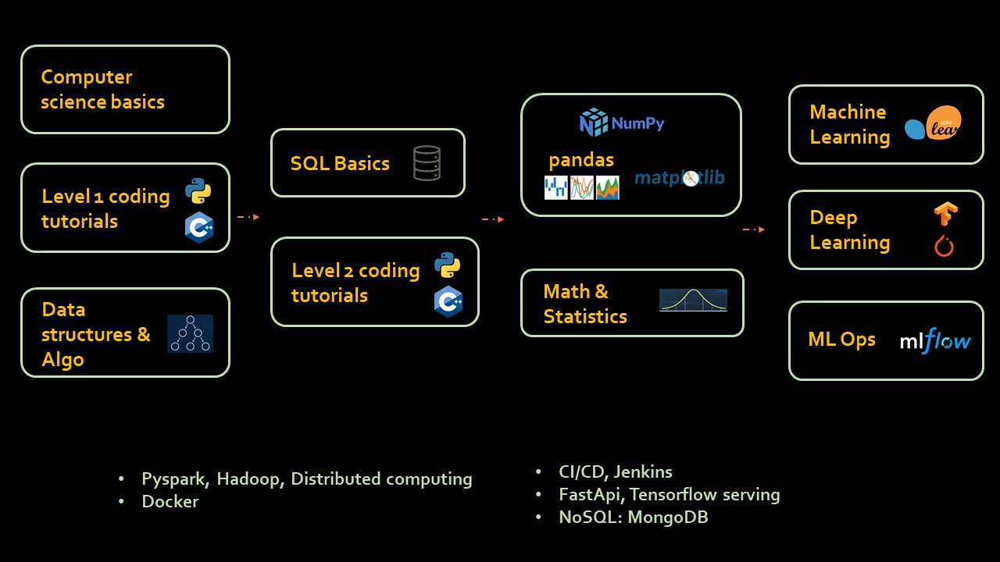
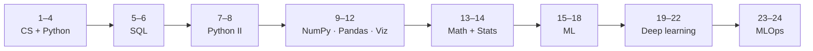

<h1 align="center">🗺️ ML Engineer Roadmap</h1>

Zero to machine learning engineer in about 24 weeks. One topic at a time, free resources only.

  
  
  

## The path

| Weeks | Topic | Resources |
|---|---|---|
| **1–4** | CS principles, Python basics, DSA | [Khan Academy CS](https://www.khanacademy.org/computing/ap-computer-science-principles/computers-101) · [Python](https://www.youtube.com/playlist?list=PLeo1K3hjS3uv5U-Lmlnucd7gqF-3ehIh0) · [Python (Hindi)](https://www.youtube.com/playlist?list=PLPbgcxheSpE1DJKfdko58_AIZRIT0TjpO) · [DSA](https://www.youtube.com/playlist?list=PLeo1K3hjS3uu_n_a__MI_KktGTLYopZ12) |
| **5–6** | SQL | [Khan Academy SQL](https://www.khanacademy.org/computing/computer-programming/sql) · [Kudvenkat SQL](https://www.youtube.com/playlist?list=PL08903FB7ACA1C2FB) |
| **7–8** | Intermediate Python | [Codebasics Python](https://www.youtube.com/playlist?list=PLeo1K3hjS3uv5U-Lmlnucd7gqF-3ehIh0): keep going through the second half |
| **9–12** | NumPy, Pandas, Matplotlib, EDA | [NumPy](https://www.youtube.com/playlist?list=PLeo1K3hjS3uset9zIVzJWqplaWBiacTEU) · [Pandas](https://www.youtube.com/playlist?list=PLeo1K3hjS3uuASpe-1LjfG5f14Bnozjwy) · [Matplotlib](https://www.youtube.com/playlist?list=PLeo1K3hjS3uu4Lr8_kro2AqaO6CFYgKOl) · [Kaggle notebooks](https://www.kaggle.com/code) |
| **13–14** | Math and statistics | [Codebasics Math](https://www.youtube.com/playlist?list=PLeo1K3hjS3uuKaU2nBDwr6zrSOTzNCs0l) · *Practical Statistics for Data Scientists* (book) |
| **15–18** | Machine learning | [Codebasics ML](https://www.youtube.com/playlist?list=PLeo1K3hjS3uvCeTYTeyfe0-rN5r8zn9rw) |
| **19–22** | Deep learning | [Codebasics DL](https://www.youtube.com/playlist?list=PLeo1K3hjS3uu7CxAacxVndI4bE_o3BDtO) |
| **23–24** | MLOps | [MLflow tutorials](https://mlflow.org/docs/latest/tutorials-and-examples/index.html) |

## Also learn

| | |
|---|---|
| 🛠️ **Engineering** | Git · Docker · CI/CD (Jenkins / GitHub Actions) · FastAPI · TensorFlow Serving |
| 🗄️ **Data at scale** | PySpark · Hadoop · NoSQL (MongoDB) |

## Tips

- **Learn how to learn:** [effective-learning video](https://www.youtube.com/watch?v=yZFrSDjRvjk).
- **Study with others:** the [Codebasics Discord](https://discord.gg/r42Kbuk).
- **Build as you go:** finish one small project per phase and push it to GitHub. Projects teach more than playlists.

## Notes

| | |
|---|---|
| Based on the Codebasics roadmap | Most links are Codebasics playlists |
| Weeks 1–4 and 7–8 used the same Python playlist | Week 7–8 now says where in the playlist to pick up |
| `ML-Roapmap` is an empty placeholder file (1 byte) | Safe to delete |
| No LLMs, vector databases or generative AI | A natural "Week 25+" extension |
